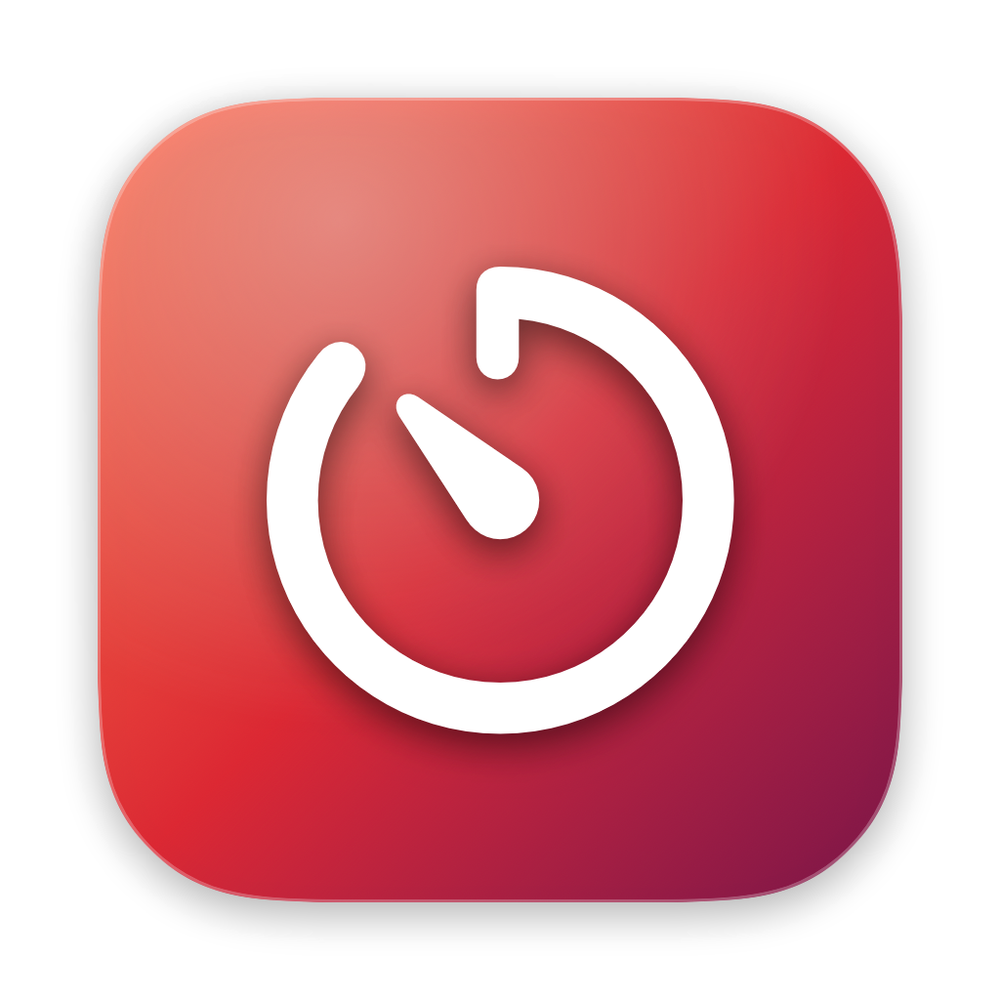
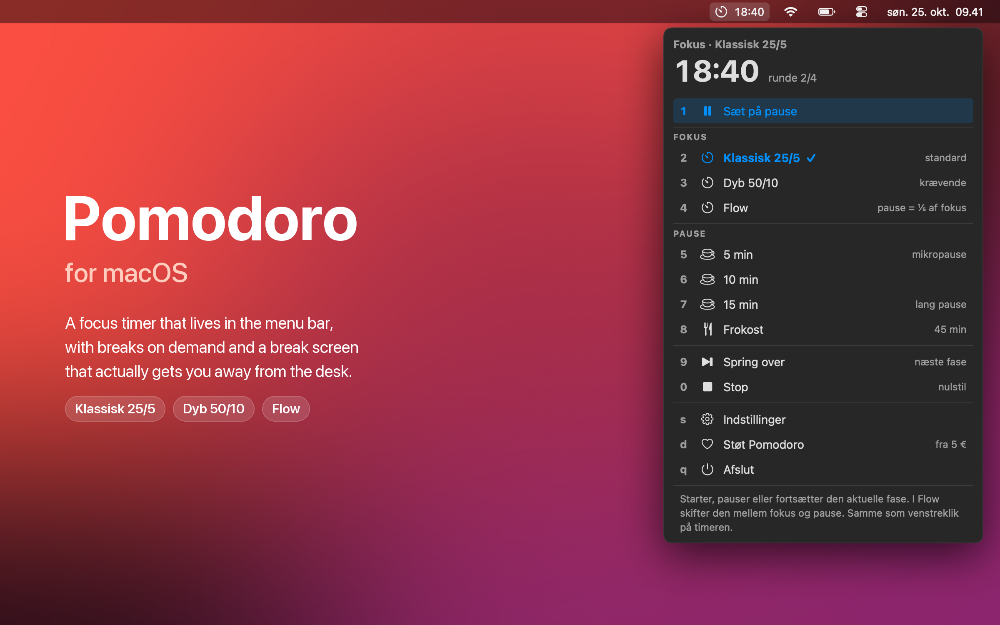
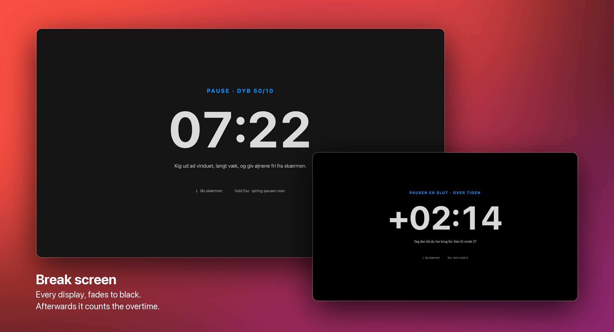

<p align="center">
  
</p>

<h1 align="center">Pomodoro for macOS</h1>

<p align="center">
  A focus timer in the menu bar, with breaks on demand<br>
  and a break screen that actually gets you away from the desk.
</p>

<p align="center">
  <a href="https://github.com/rallevondalle/macos-pomodoro/releases/latest/download/Pomodoro.dmg"></a>
</p>

<p align="center">
  <a href="https://github.com/rallevondalle/macos-pomodoro/releases/latest"></a>
  
  
  
  <a href="LICENSE"></a>
</p>



## What it does

- **Three rhythms.** Klassisk 25/5, Dyb 50/10 for demanding work, and Flow,
  which counts up and gives you a break of ⅕ of your focus time.
- **Breaks on demand.** 5, 10 or 15 minutes, or lunch, whenever you need one.
- **A break screen** that covers every display, so "just finishing this" isn't an option.
- **Keyboard first.** Every action has a number key in the panel.
- **Survives sleep and restarts.** The timer runs on deadlines, and time asleep counts as break.
- **Small and native.** One Swift app of under 2 MB, no Electron, no account, no tracking.

> The interface is in Danish: Fokus = focus, Pause = break, Frokost = lunch, Dyb = deep.

## Install

1. [Download Pomodoro.dmg](https://github.com/rallevondalle/macos-pomodoro/releases/latest/download/Pomodoro.dmg),
   open it and drag **Pomodoro** to **Applications**.
2. Start it. The timer shows up in the menu bar, and macOS asks once whether it may send notifications.
3. Turn on **Start ved login** in the panel's settings (`s`) if you want it every day.

The app is signed with a Developer ID and notarized by Apple, so it opens without warnings.

**Can't see the timer?** When the menu bar is full, macOS hides new icons without a word.
Make room by ⌘-dragging other icons off. A menu bar manager like Bartender may file it
under "Always Hidden" at first: move it to "Shown" once and it stays there.

## Use

| In the menu bar | Action |
| --- | --- |
| Left click | Start / pause / resume (Flow: focus ⇄ break) |
| Right click or ⌃-click | Open the panel |
| Middle click | Skip to the next phase |
| Scroll | ±1 minute on the running countdown |

In the panel, every action has a number key (`1`–`9`, `0`), so **right click → 3**
starts a deep-work session. Arrows or `j` `k` + Enter work too, `s` opens the
settings, `q` quits and Esc goes back or closes. Hovering a row explains it at
the bottom of the panel.

**Focus modes**

- **Klassisk 25/5**: 25 min focus, 5 min break, 15 min break after 4 rounds.
- **Dyb 50/10**: 50 min focus, 10 min break, 30 min break after 2 rounds.
- **Flow**: counts up. When your focus drops, click the timer to take the break,
  which is ⅕ of the focus time (2–30 min). Click again to go back. A nudge comes after 90 min.

A break taken mid-focus doesn't count that round towards the long break.

## Break screen



During breaks in Dyb (or in every break, if you choose so in the settings) a
dark screen takes over every display with a big countdown and a suggestion for
what to do. It fades to black over ten seconds, hides the Dock and menu bar
and blocks ⌘-Tab.

- `L` locks the Mac if you leave the desk.
- Hold `Esc` for two seconds to skip the break.
- When the break runs out, the screen stays up and counts the overtime, so a
  longer break than planned is still a break. `Enter` or `Space` starts the next
  focus, and so does `Esc` while **Start fokus ved luk** is on.

## Settings

In the panel (`s`): lunch length, when to show the break screen (Dyb only / all
breaks / off), whether closing it starts the next focus, start at login, and
which actions appear in the menu.

The classic mode's lengths are set from the terminal:

```bash
defaults write com.rallevondalle.pomodoro workMinutes -int 30
# also: shortBreakMinutes, longBreakMinutes, roundsPerLongBreak
```

## Command line and shortcuts

The app binary doubles as a CLI. Link it once:

```bash
ln -s /Applications/Pomodoro.app/Contents/MacOS/Pomodoro ~/.local/bin/pomodoro
```

```bash
pomodoro panel                 # open/close the panel: bind it in Raycast, Alfred or Shortcuts
pomodoro toggle | skip | stop | status | mode
pomodoro focus deep            # classic | deep | flow
pomodoro takeBreak 10
pomodoro lunch
pomodoro cycleBreakScreen      # deep → all → off
pomodoro toggleAutoRestart | dismissBreakScreen | setMode flow
```

## Why it works like this

The research on breaks is small and not fully consistent. These are the
findings behind the choices:

| Finding | Design choice |
| --- | --- |
| Students with fixed breaks reported less fatigue and distraction and more concentration than students who chose their own breaks, with the same task completion. ([Biwer et al., 2023](https://pubmed.ncbi.nlm.nih.gov/36859717/)) | Focus always rolls straight into a break. The timer, not willpower, decides when to stop. |
| Pomodoro, Flowtime (break proportional to focus) and self-chosen breaks showed no differences in productivity or flow. ([PMC12292963](https://pmc.ncbi.nlm.nih.gov/articles/PMC12292963/)) | Flow mode with a ⅕ break, for work where a fixed bell breaks your flow. |
| Micro-breaks (≤10 min) give a small boost in vigor; demanding tasks may need breaks over 10 min. ([Albulescu et al., 2022](https://doaj.org/article/c6f37b6ba159469296b2cb968b65505f)) | A deep mode with 10/30 min breaks, and 15 min and lunch breaks at any time. |
| Phone use on the lunch break left people more emotionally exhausted later in the day. ([Rhee & Kim, via APS](https://www.psychologicalscience.org/news/minds-business/why-you-should-break-up-with-your-smartphone-during-lunch-breaks.html)) | Break tips suggest moving, looking into the distance, water or talking to someone, and leaving the phone alone. |

Some choices rest on convenience rather than evidence: a finished break waits
for you instead of starting the next focus on its own, the 90-minute nudge in
Flow is a soft reminder, and lunch defaults to 45 minutes.

## Also for Linux

This is a native port of [omarchy-pomodoro](https://github.com/rallevondalle/omarchy-pomodoro),
the same timer for the [Omarchy](https://omarchy.org/) bar on Linux, ported at
[`987c979`](https://github.com/rallevondalle/omarchy-pomodoro/commit/987c979).
On the Mac the icons are SF Symbols, the colours follow macOS, and the break
screen can't take the keyboard exclusively the way a Wayland overlay can, so it
hides the Dock and menu bar, blocks app switching and takes the focus back if it loses it.

## Build from source

Needs Xcode's Swift toolchain, no Xcode project.

```bash
./install.sh     # builds, copies to ~/Applications, links ~/.local/bin/pomodoro, starts it
```

- `./build.sh` builds a universal app in `build/`. It signs with the Developer ID
  Application identity in the keychain and the hardened runtime, or ad hoc when there is none.
- `./release.sh` also packs a DMG, notarizes it with the notarytool profile in
  `NOTARY_PROFILE` (default `cratedigger-notary`), staples the ticket and checks it with Gatekeeper.
- `tools/make-icon.sh` redraws `AppIcon.icns` from `tools/icon.swift`.

State lives in `~/Library/Application Support/Pomodoro/state.json`.

## License

MIT
